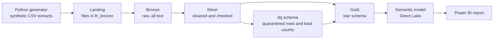

# Treatment case management pipeline in Microsoft Fabric

This is a Microsoft Fabric pipeline for a fictional drug and alcohol treatment provider. Each week it takes the export from the provider's case management system, checks it row by row and feeds a Power BI report. The data is synthetic with errors planted on purpose, and the project shows every one is caught and no row goes missing.

Built with: Fabric lakehouses (Delta tables), Spark SQL notebooks, PySpark, Data Factory pipelines, a Direct Lake semantic model, Power BI, Python and pytest.


The Service overview page, all synthetic data.

## At a glance

- 354 errors were planted across four extracts: 312 in the historical one and 14 in each weekly one. In every extract the dq tables count the same fixes, removals and quarantines as the answer key, as the [defect results](docs/defect-results.md) show.
- Every load reconciles, table by table, or the run fails.
- Loading the same week twice inserts and updates nothing.
- An extract with a missing column fails before anything's written. It's retried on the next run, never skipped.
- Tests cover the generator and the SQL view files.

## How the data flows



### The data

None of it's real. A Python generator in `extract_generator/` stands in for the case management system and writes a historical extract, three weekly ones and one that's broken on purpose. It plants the mistakes real exports have, like duplicates, day-first dates, lower-case codes and orphan rows, and lists each one with its expected outcome in a manifest, the answer key.

### Bronze

nb_load_bronze loads one extract at a time from the landing folder in lh_bronze. Every column stays text. If Bronze typed dates on the way in, a day-first date would fail or come out null and Silver would never see the error.

### Silver

nb_load_silver removes duplicates and checks every row against the data quality rules. It fixes a value only when there's one right answer. Anything else that breaks a rule goes to dq.quarantine, and clean rows go in with a MERGE that won't take an older last_modified_at.


dq.quarantine: 122 rejected rows across four extracts, each with its rule, a plain English reason and the original Bronze row.


dq.reconciliation: the lower boxed rows are a rerun of 2026-11-08, which inserts and updates nothing.

### Gold and the model

nb_load_gold rebuilds Gold, a small star schema, from Silver in full on every run. The reporting date is the latest extract's cut-off, not today. The semantic model reads Gold in Direct Lake mode, so there's no import to refresh.


The semantic model: Episodes in the middle with its six dimensions, and two standalone tables for data quality and the reporting date.

### The report

Two pages. Service overview covers people in treatment, waits to triage, planned completions and referrals. Data quality shows what was loaded, fixed, removed and quarantined for each extract. Anyone reading the first page can check it against the second.


The Data quality page. Fixed, removed and quarantined match the generator's answer key for every extract.

### The pipeline

pl_load_extract runs one extract end to end. Its first step picks the oldest landed extract with no successful run in ops.run_log. A failed step is logged, then a Fail activity marks the run Failed.


pl_load_extract. The boxed branch logs a failure, then fails the run.


Runs on the morning of 25 November 2026. Both failures are the broken extract 2026-11-22.


The broken extract stops at the column check: interventions.csv has no end_date, so nothing was written. This run predates the Load Gold step.

A second pipeline, pl_load_public_data, loads three public datasets into a local authority table in Gold. More detail and the design decisions are in the [build story](docs/how-it-works.md).

## Proving it with SQL

Passing runs aren't proof, so I checked the tables directly in nb_sql_checks.


Every run balances, reruns included.


People in treatment by service from Gold, the same six numbers as the report.

## Known gaps and next steps

- Show Planned Completion (%) per service.
- Show the wait to triage per service.
- Split referrals per month by referral source and mark the latest month as partial.
- Give every visual a plain title.
- Label the Last Successful Load time as UTC.
- Send an alert when a run fails.
- Add an API source.
- The public data stage still needs a full check.
- Promote the items to a test workspace.

## How to run it

You'll need Python 3 and a Fabric capacity. I used an F2.

```
py -3 -m venv .venv
.venv\Scripts\python -m pip install -r requirements-dev.txt
.venv\Scripts\python -m extract_generator --seed 2026 --out output
.venv\Scripts\python -m pytest
```

Connect a Fabric workspace to this repo with Git integration on `fabric/`, then update it from Git. A tenant admin has to allow GitHub sync first, and each notebook may need its default lakehouse attached again. Upload `output/` to `Files/landing/` in lh_bronze, keeping the folder names, and run pl_load_extract once per extract with `extract_id` empty. The fifth run hits the broken extract and fails, as it should. The [runbook](docs/runbook.md) covers the rest.

## Data and licences

The treatment data is synthetic and the six services are fictional, though their districts are real: Middlesbrough, Blackpool, Brighton and Hove, Cornwall, Leeds and Lewisham. The data model and code lists are my own design, not any provider's or a national dataset's. I used the public NDTMS Core Dataset documents for concepts only.

The public data is three files from the Ministry of Housing, Communities and Local Government and ONS under the [Open Government Licence v3.0](https://www.nationalarchives.gov.uk/doc/open-government-licence/version/3/). Contains public sector information licensed under the Open Government Licence v3.0. Source: Office for National Statistics licensed under the Open Government Licence v.3.0. Links and file fingerprints are in the [public data notes](docs/public-data.md).

The code is under the [MIT licence](LICENSE).

## Repo layout

| Folder | What it holds |
|---|---|
| `extract_generator/` | The synthetic data generator |
| `tests/` | Tests for the generator and the view files |
| `fabric/` | The Fabric items as Git integration saves them |
| `sql/` | The reporting views and the script that deploys them |
| `docs/` | The build story, [decisions log](docs/decisions.md), [source to target mapping](docs/source-to-target.md), runbook, public data notes and screenshots |

Author: Bayar Dilzar
