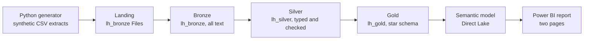

# fabric-case-management-pipeline

I built this Microsoft Fabric pipeline to take weekly extracts from a made-up drug and alcohol treatment case management system through Bronze, Silver and Gold lakehouses into a Power BI report. The data is synthetic, made by a Python generator I designed, and the data model is my own design, not any real provider's.

The treatment strand (M1 to M4) is built, run and checked in my own Fabric workspace. The public data strand (M5) is built but not reviewed by me.

I built it in five stages, and the docs refer to them:

- M1: the extract generator and Bronze
- M2: Silver and the data quality checks
- M3: weekly incremental loads, the run log and failure handling
- M4: Gold, the reporting views, the semantic model and the report
- M5: public data by local authority

## How it fits together

### Generator

The generator in `extract_generator/` runs on my laptop. From one seed it builds about three and a half years of clients, episodes, interventions and reviews for six fictional services in six real English districts. It writes one historical extract, three weekly extracts that hold only new and changed rows, and one broken extract whose interventions file has no `end_date` column. It also plants known mistakes in the files and lists every one in a manifest, 312 in the historical extract, so the checks in Fabric can be tested against an answer key. The same seed always gives the same files, byte for byte.

### Landing

The generator's output goes into `Files/landing/` in lh_bronze, one folder per extract date, with its manifest next to it.

### Bronze

nb_load_bronze loads one extract into Delta tables in lh_bronze. Every column stays text, and three load columns record the extract, the source file and the load time. Text means bad values survive for the Silver checks, and Bronze row counts match the files exactly. Before it writes anything, it checks the columns of every file, so the broken extract stops here. A rerun replaces only that extract's rows.

### Silver

nb_load_silver checks each row of an extract against 44 rules, and every row ends up with one of three outcomes:

- Fixed: the value has one right answer, so Silver corrects it. Spaces are trimmed, codes are upper-cased, and dates written as DD/MM/YYYY or YYYYMMDD are read as dates.
- Removed: another row has the same business key. Silver keeps the one with the latest `last_modified_at`.
- Quarantined: anything else, such as an unknown code, a missing parent or a broken business rule. The row goes to `dq.quarantine` with its rule ids, a reason and the original Bronze row as JSON. Its child rows are quarantined with it.

Clean rows are merged into Silver on the business key, and a stored row only changes when the incoming `last_modified_at` is newer. So a rerun, or an older extract that arrives late, changes nothing. Each run also writes `dq.reconciliation`, where Bronze rows must equal inserted + updated + unchanged + removed + quarantined for every table, and the run fails if one does not balance.

### Gold

nb_load_gold rebuilds lh_gold from Silver on every run, in about a minute. It is a small star schema: `fact_episode` has one row per episode, with dimensions for client, service, date, referral source, substance and discharge reason. `fact_extract_load` holds the data quality figures for each extract, and `report_settings` holds the reporting date and the 21 day wait threshold. The reporting date is the cut-off of the latest loaded extract, never today, so the same data always gives the same answers. Six T-SQL views in `sql/reporting/` answer the same questions for analysts on the lh_gold SQL endpoint.

### Semantic model and report

sm_case_management reads the Gold tables in Direct Lake mode, so there is no imported copy to refresh. rpt_case_management has two pages, Service overview and Data quality.

### Orchestration

pl_load_extract runs one extract end to end. nb_resolve_extract picks the oldest landed extract with no successful run, then the pipeline runs Bronze, Silver and Gold and writes one row to `ops.run_log`. When a step fails, the pipeline logs the failure and a Fail activity marks the run Failed, so monitoring never shows a false success. Only one run goes at a time. A daily schedule exists but is switched off, because I pause the capacity when I am not working on it.

### Public data

pl_load_public_data downloads three official files: the English Indices of Deprivation 2025, ONS deaths related to drug poisoning by local authority, and the ONS district to region lookup. It loads them through Bronze and Silver into `reference` schemas and builds `lh_gold.dbo.dim_local_authority`, one row per English district, which joins to `dim_service` on the district code. It is not in the semantic model or the report yet. The public data strand (M5) is built but not reviewed by me.

Every design choice, with the alternatives and the reason, is in [docs/decisions.md](docs/decisions.md). Column by column mappings are in [docs/source-to-target.md](docs/source-to-target.md).
