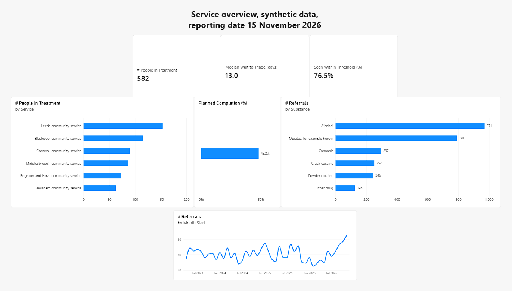
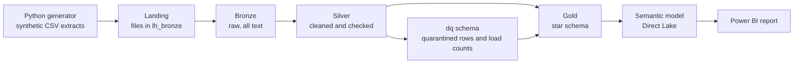

# Treatment case management pipeline in Microsoft Fabric

I built a data pipeline in Microsoft Fabric for a fictional drug and alcohol treatment provider. Each week it takes the export from the provider's case management system, checks and cleans every row, and feeds a Power BI report on caseload, waiting times and data quality. The data is synthetic, with errors planted in it on purpose, and the project shows that every error is caught and every row is accounted for.



The report's first page: 582 people in treatment, a 13 day median wait to triage and 76.5% seen within 21 days, all from synthetic data.

## At a glance

- 354 of 354 planted errors handled the way the answer key says: 312 in the historical extract and 14 in each of the three weekly ones. Each was fixed, removed as a duplicate or quarantined, and none went missing.
- Every load reconciles, which means the rows that come in equal the rows that go out, table by table.
- Loading the same week a second time changes nothing. The rerun inserted 0 rows and updated 0.
- A broken extract with a missing column fails before anything is written, every time it is tried, and is never skipped.
- People in treatment for each service on the report match a separate SQL query over the data.
- 101 automated tests check the data generator and the SQL view files.

## How the data flows

The pipeline follows the medallion pattern: data moves through three layers, Bronze, Silver and Gold, and gets cleaner at each one.



### Generator

The generator in `extract_generator/` runs on my laptop. From one seed it builds about three and a half years of clients, episodes, interventions and reviews for six fictional services in six real English districts. It writes one historical extract, three weekly extracts that hold only new and changed rows, and one broken extract whose interventions file has no `end_date` column. It also plants known mistakes in the files and lists every one in a manifest, 312 in the historical extract, so the checks in Fabric can be tested against an answer key. The same seed always gives the same files, byte for byte.

### Landing

The generator's output goes into `Files/landing/` in lh_bronze, one folder per extract date, with its manifest next to it.

### Bronze

nb_load_bronze loads one extract into Delta tables in lh_bronze. Every column stays text, and three load columns record the extract, the source file and the load time. Text means bad values survive for the Silver checks, and Bronze row counts match the files exactly. Before it writes anything, it checks the columns of every file, so the broken extract stops here. A rerun replaces only that extract's rows.

### Silver

nb_load_silver checks each row of an extract against 48 rules, and every row ends up with one of three outcomes:

- Fixed: the value has one right answer, so Silver corrects it. Spaces are trimmed, codes are upper-cased, and dates written as DD/MM/YYYY or YYYYMMDD are read as dates.
- Removed: another row has the same business key. Silver keeps the one with the latest `last_modified_at`.
- Quarantined: anything else, such as an unknown code, a missing parent or a broken business rule. The row goes to `dq.quarantine` with its rule ids, a reason and the original Bronze row as JSON. Its child rows are quarantined with it.

Clean rows are merged into Silver on the business key, and a stored row only changes when the incoming `last_modified_at` is newer. So a rerun, or an older extract that arrives late, changes nothing. Each run also writes `dq.reconciliation`, where Bronze rows must equal inserted + updated + unchanged + removed + quarantined for every table, and the run fails if one does not balance.

### Gold

nb_load_gold rebuilds lh_gold from Silver on every run, in about a minute. It is a small star schema: `fact_episode` has one row per episode, with dimensions for client, service, date, referral source, substance and discharge reason. `fact_extract_load` holds the data quality figures for each extract, and `report_settings` holds the reporting date and the 21 day wait threshold. The reporting date is the cut-off of the latest loaded extract, never today, so the same data always gives the same answers. Six T-SQL views in `sql/reporting/` answer the same questions for analysts on the lh_gold SQL endpoint.

### Semantic model and report

sm_case_management reads the Gold tables in Direct Lake mode, so there is no imported copy to refresh. rpt_case_management has two pages, Service overview and Data quality.

### Orchestration

pl_load_extract runs one extract end to end. nb_resolve_extract picks the oldest landed extract with no successful run, then the pipeline runs Bronze, Silver and Gold and writes one row to `ops.run_log`. When a step fails, the pipeline logs the failure and a Fail activity marks the run Failed, so monitoring never shows a false success. Only one run goes at a time. A daily schedule exists but is switched off, because I pause the capacity when I am not working on it.

### Public data

pl_load_public_data downloads three official files: the English Indices of Deprivation 2025, ONS deaths related to drug poisoning by local authority, and the ONS district to region lookup. It loads them through Bronze and Silver into `reference` schemas and builds `lh_gold.dbo.dim_local_authority`, one row per English district, which joins to `dim_service` on the district code. It is not in the semantic model or the report yet. The public data strand (M5) is built but not reviewed by me.

Every design choice, with the alternatives and the reason, is in [docs/decisions.md](docs/decisions.md). Column by column mappings are in [docs/source-to-target.md](docs/source-to-target.md).

## What Gold answers

All six as of 15 November 2026. How each one is measured is in [docs/decisions.md](docs/decisions.md#how-each-question-is-measured).

1. How many people are in treatment now? 582: Leeds 154, Blackpool 115, Cornwall 90, Middlesbrough 87, Brighton and Hove 73, Lewisham 63. In treatment means an episode with no discharge date.
2. How many new referrals come in each month, and from where? 2,683 over 44 months, April 2023 to November 2026. Self-referral 1,198, criminal justice 533, GP 415, other health or social care 317, and family, friend or carer 220. November 2026 only runs to the 15th and has 85.
3. How long do people wait from referral to triage? The median is 13 days at every service. 76.5% of the 2,600 triaged episodes (1,989) were seen within 21 days, from 72.8% at Cornwall to 80.0% at Blackpool. 83 episodes are not triaged yet, so they have no wait.
4. What share of discharges are planned completions? 48.2%, or 1,012 of 2,101. Leeds 51.0%, Cornwall 50.0%, Lewisham 49.1%, Middlesbrough 47.4%, Blackpool 44.9%, Brighton and Hove 44.1%.
5. What is the primary substance at referral? Alcohol 971 (36.2%), opiates 791 (29.5%), cannabis 297 (11.1%), crack cocaine 252 (9.4%), powder cocaine 246 (9.2%) and other drugs 126 (4.7%).
6. Can the figures be trusted? Each extract's rows, as Silver handled them:

   | Extract | Rows loaded | Values fixed | Rows removed | Rows quarantined |
   |---|---|---|---|---|
   | 2026-10-25 | 13,959 | 95 | 110 | 107 |
   | 2026-11-01 | 274 | 5 | 4 | 5 |
   | 2026-11-08 | 268 | 5 | 4 | 5 |
   | 2026-11-15 | 265 | 5 | 4 | 5 |
   | Total | 14,766 | 110 | 122 | 122 |

   Rows loaded counts the four extract files. The last successful load was on 25 November 2026 at 06:40 UTC.

## Screenshots


Bronze keeps each extract exactly as it arrived. Every source column is text, so bad values survive for the Silver checks, and three load columns record the extract, the source file and the load time.


pl_load_extract picks the oldest extract not yet loaded, then runs Bronze, Silver and Gold in order. When a step fails, the pipeline logs the failure, then a Fail activity marks the run as Failed (boxed).


Runs of pl_load_extract on the morning of 25 November 2026. The two failures are the broken extract 2026-11-22, which fails each time it is tried rather than being skipped.


The broken extract fails the schema check before anything is written: interventions.csv is missing end_date. This run is from before Load Gold was added to the pipeline.


Silver is typed: birth_year is a number and last_modified_at a timestamp. The data quality tables sit in their own dq schema.


122 rejected rows across four extracts, each kept with the rule it broke, a plain English reason and the original Bronze row.


Every extract reconciles: Bronze rows = inserted + updated + unchanged + duplicates removed + quarantined. The boxed rows are 2026-11-08 loaded once, then rerun. The rerun inserts and updates nothing.


ops.run_log has one row per pipeline run, with the extract, timings, status and the step that failed (boxed). The broken extract 2026-11-22 fails at Load Bronze every time it is tried. Nothing to load is a run with no new extract waiting.


The Gold star schema as the semantic model sees it. Episodes joins to six dimensions: client, service, date, substance, referral source and discharge reason. Extract Loads and Report Settings stand alone and feed the data quality page and the reporting date.


Rows loaded, quarantined, fixed and removed for each extract, copied into Gold from the dq tables in Silver, with the time of the last successful load. The 122 quarantined rows match the quarantine table above.

## SQL checks

I checked the pipeline from the tables themselves with five Spark SQL queries in the nb_sql_checks notebook. Each one proves something different.

1. [Duplicates in Bronze](docs/images/13-sql-duplicates-in-bronze.png). 20 client ids arrive twice in the historical extract, which matches the 20 duplicates Silver removed from clients. So Bronze keeps what arrived, and the removing happens in Silver.
2. Every load reconciles (below). For each of the seven runs, Bronze rows equal inserted + updated + unchanged + duplicates removed + quarantined, reruns included. So no row was lost or counted twice. These totals include the services and code list files, so each is 31 rows higher than Rows loaded above.
3. [Quarantine by rule](docs/images/15-sql-quarantine-by-rule.png). The 122 quarantined rows fall into 12 groups of rule ids, so every held-back row says which rule it broke. One row can break more than one rule.
4. [Run history by status](docs/images/16-sql-run-history-by-status.png). 2026-11-22 failed on all four attempts, 2026-11-08 succeeded twice and 2026-11-15 three times. So a broken extract is retried, not skipped, and a rerun succeeds.
5. Gold matches the report (below). People in treatment by service from a join of fact_episode and dim_service gives 154, 115, 90, 87, 73 and 63, the same as the report.


The tests in `tests/` check the generator: the same seed gives the same bytes, and the manifest lists exactly the defects that a separate detector finds in the files, for five seeds. A test also checks that each file in `sql/reporting/` creates the view it is named after.

## How to run it

I ran it with Python 3.10 on my machine and an F2 Fabric capacity.

```
py -3 -m venv .venv
.venv\Scripts\python -m pip install -r requirements-dev.txt
.venv\Scripts\python -m extract_generator --seed 2026 --out output
.venv\Scripts\python -m pytest
```

Then connect a Fabric workspace to this repo with Git integration, using the `fabric/` folder, and update it from Git. A tenant admin has to allow syncing with GitHub first. I have only run it in my own workspace, so in a new one each notebook may need its default lakehouse attached again. Upload `output/` into `Files/landing/` in lh_bronze, keeping the folder names, and run pl_load_extract with `extract_id` empty once per extract. The fifth run reaches the broken extract and fails, as it should. `python sql/deploy_views.py <workspace name>` deploys the reporting views after `az login`, and pl_load_public_data loads the public data. The [runbook](docs/runbook.md) has the checks, reruns and recovery steps.

## Limitations and what I would do next

The data is synthetic, so nothing here is a finding about a real provider. I upload the extracts manually, and a run takes 9 to 10 minutes on F2. The daily schedule is switched off because I pause the capacity between sessions, so every run so far was started manually. If a run stops halfway, some tables are updated and others not until the next run repeats the extract, which is safe. In the public data, Barnsley and Sheffield have no drug poisoning figures, because the ONS file uses their newer district codes and they are not remapped. The [public data notes](docs/public-data.md#limits) list the rest.

The report has five open flaws, all visible in its definition in `fabric/` and in the screenshots:

- Planned Completion (%) has no service on its axis, so it shows one bar for all services (48.2%), not one per service.
- The wait to triage appears only as two cards for all services together. The figures for each service are in Gold and in the views, but not on the page.
- Referrals per month is one line with no split by referral source, and its last point, November 2026, only runs to the 15th without saying so.
- The visual titles are the default field names, such as "# People in Treatment by Service", not plain titles.
- The Last Successful Load card shows 25 Nov 2026 06:40 with no time zone. The time is UTC.

Next I would fix those flaws, review the public data and add dim_local_authority to the semantic model, and promote the items to a test workspace with a deployment pipeline. I would also log public data runs in ops.run_log; for now their row counts only live in the pipeline run history.

## Data sources and licences

The treatment data is synthetic and the six services are fictional, though their districts are real: Middlesbrough, Blackpool, Brighton and Hove, Cornwall, Leeds and Lewisham. The fields, code lists and data model are my own design, not any provider's or a national dataset's. I used the public NDTMS Core Dataset documents as a guide to concepts only.

The public data is three files under the [Open Government Licence v3.0](https://www.nationalarchives.gov.uk/doc/open-government-licence/version/3/): the English indices of deprivation 2025, File 10 version 2, from the Ministry of Housing, Communities and Local Government; deaths related to drug poisoning by local authority, England and Wales, registrations up to 2025, from ONS; and the Local Authority District to Region (December 2024) Lookup in EN from the ONS Open Geography Portal. Contains public sector information licensed under the Open Government Licence v3.0. Source: Office for National Statistics licensed under the Open Government Licence v.3.0. Page and file links, columns and file fingerprints are in [docs/public-data.md](docs/public-data.md).

The code is under the [MIT licence](LICENSE).

## Repo layout

| Folder | What it holds |
|---|---|
| `extract_generator/` | The synthetic data generator |
| `tests/` | Tests for the generator and the view files |
| `fabric/` | The Fabric items as Git integration saves them: lakehouses, notebooks, pipelines, the semantic model and the report |
| `sql/` | The six reporting views and the script that deploys them |
| `docs/` | The [decisions log](docs/decisions.md), [source to target mapping](docs/source-to-target.md), [runbook](docs/runbook.md), [public data notes](docs/public-data.md) and the screenshots |

Author: Bayar Dilzar
