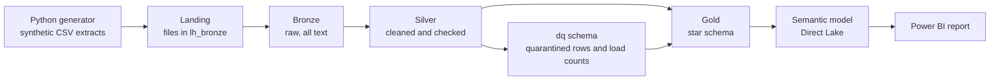
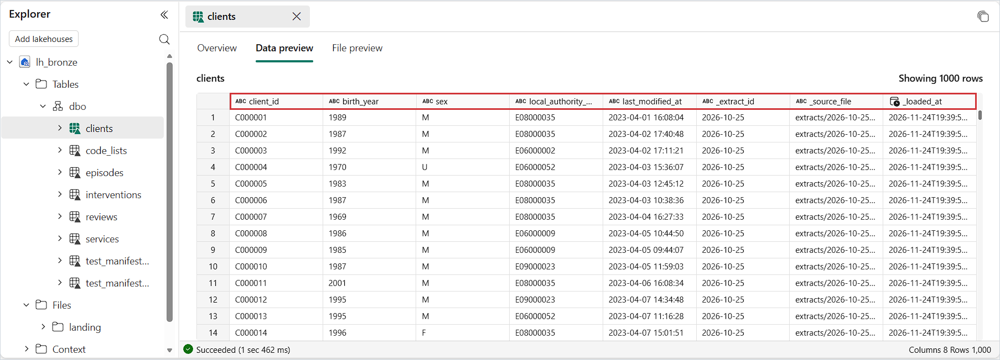
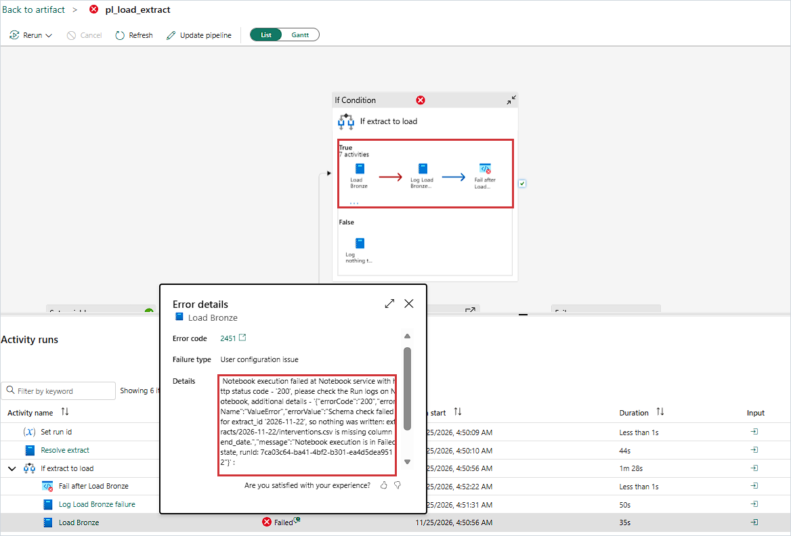
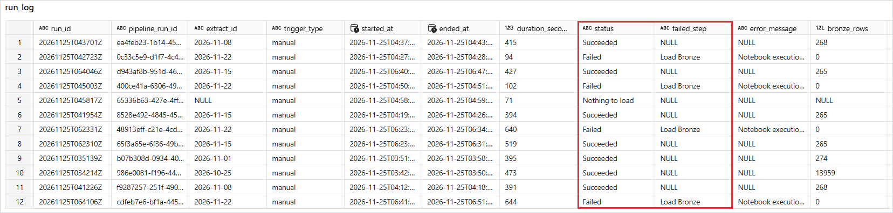
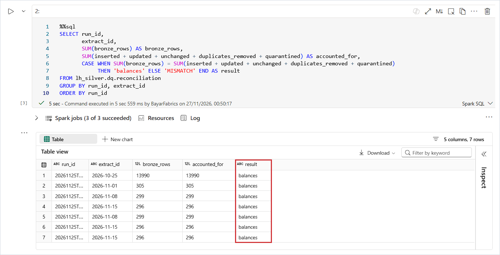
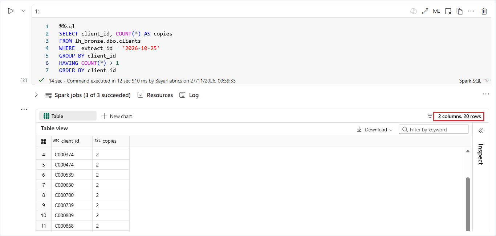
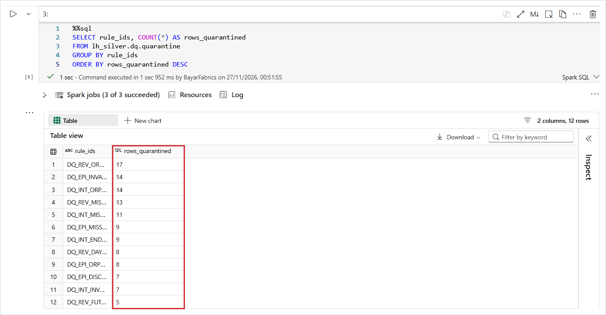
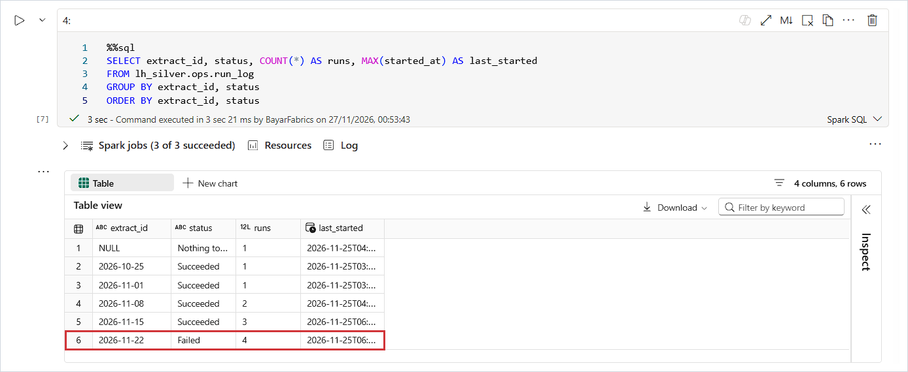

# Treatment case management pipeline in Microsoft Fabric

I built a data pipeline in Microsoft Fabric for a fictional drug and alcohol treatment provider. Each week it takes the export from the provider's case management system, checks and cleans every row, and feeds a Power BI report on caseload, waiting times and data quality. The data is synthetic, with errors planted in it on purpose, and the project shows that every error is caught and every row is accounted for.


The report's first page: 582 people in treatment, a 13 day median wait to triage and 76.5% seen within 21 days, all from synthetic data.

## At a glance

- 354 of 354 planted errors handled the way the answer key says: 312 in the historical extract and 14 in each of the three weekly ones. Each was fixed, removed as a duplicate or quarantined, and none went missing.
- Every load reconciles, which means the rows that come in equal the rows that go out, table by table.
- Loading the same week a second time changes nothing. The rerun inserted 0 rows and updated 0.
- A broken extract with a missing column fails before anything is written, every time it is tried, and is never skipped.
- People in treatment for each service on the report match a separate SQL query over the data.
- 101 automated tests check the data generator and the SQL view files.

## How the data flows

The pipeline follows the medallion pattern: data moves through three layers, Bronze, Silver and Gold, and gets cleaner at each one.



## How I built it

I built it in stages, and the docs call them M1 to M5. M1 is the generator and Bronze, M2 is Silver, M3 is the weekly loads and the pipeline around them, M4 is Gold and the report, and M5 is the public data.

### The data

None of the treatment data is real. I designed a Python generator, in `extract_generator/`, that plays the part of the provider's case management system. From one seed it builds about three and a half years of clients, episodes of care, interventions and reviews for six fictional services in six real English districts. It exports them as CSV files: one large historical extract, three weekly extracts holding only new and changed rows, and one broken extract with a column missing. On the way out it plants the kind of errors real exports have, such as duplicate rows, dates written day first, codes in the wrong case and rows that point at a client who does not exist. Every planted error goes into a manifest with the outcome the pipeline should reach, so the manifest is an answer key that the pipeline in Fabric is marked against.

### Landing and Bronze

Fabric keeps data in lakehouses, which hold plain files next to Delta tables (tables stored as Parquet files with a transaction log, so a write either lands in full or not at all). The generator's files are uploaded to a landing folder in lh_bronze, one folder per extract date, and nb_load_bronze loads one extract at a time into Bronze, the raw layer. Bronze keeps each extract exactly as it arrives, so nothing is lost. Every column is stored as text, with three extra columns for the extract, the source file and the load time. Text is a deliberate choice: if Bronze turned dates into dates on the way in, a date written day first would fail or come out empty, and the error would vanish before Silver could see it. Loading the same extract again replaces only that extract's rows.



Bronze clients: every source column is text, and the last three columns record the extract, the file and the load time.

### Silver: cleaning and checking

Silver is the cleaned layer, where nb_load_silver checks every row against 48 rules. Silver cleans it: it removes duplicates, fixes what it safely can, and quarantines bad rows with a reason instead of deleting them. A fix is only allowed when there is one right answer, like a code typed in lower case. HEROIN in a substance column probably means the code OPIATE, but no value in Silver is a guess, so that row goes to quarantine with the rule it broke and a copy of the original row. Clean rows go into Silver with a MERGE, which inserts new records and updates existing ones by their key. A stored row only changes when the incoming copy is newer, so a rerun or a late, older extract cannot overwrite it. Then every load is reconciled, so every row is accounted for: for each table, the rows in Bronze must equal the rows inserted, updated, unchanged, removed and quarantined, or the run fails.


Silver clients: birth_year is now a number, and the data quality tables live in their own dq schema.


dq.quarantine: 122 rejected rows across four extracts, each with its rule, a plain English reason and the original Bronze row.


dq.reconciliation: the lower boxed rows are a rerun of 2026-11-08, which inserts and updates nothing.

### Gold and the semantic model

Gold, the reporting layer, is rebuilt in full from Silver on every run. It is small, 2,683 episodes and 2,090 clients after four extracts, and a rebuild took 28 to 73 seconds in test runs, so it costs little and Gold can never drift out of step with Silver. It is a star schema: one central fact table with a row per episode of care, and small dimension tables around it for client, service, date, referral source, substance and discharge reason. Every question the report asks is a count of episodes filtered by one of those, which is the shape a star handles best. The reporting date is the cut-off of the latest extract, never today, so the same data always gives the same answers. On top sits the semantic model, the set of tables, relationships and measures that Power BI reads, in Direct Lake mode, so Power BI reads the Gold Delta tables where they are and there is no imported copy to refresh.


The semantic model: Episodes in the middle with its six dimensions, and two standalone tables for data quality and the reporting date.

### The report

The report has two pages. Service overview, the screenshot at the top, covers the provider's everyday questions: how many people are in treatment, how long they wait for triage, how many leave with a planned completion, and which substances bring them in. Data quality covers the question under all of those, whether the figures can be trusted. For each extract it shows how many rows were loaded, fixed, removed and quarantined, and when the last good load ran. I put that page in the report itself so that anyone reading the first page can check the second. Some visuals still need work, and the open flaws are listed under [Limitations](#limitations-and-what-i-would-do-next).


The Data quality page. Fixed, removed and quarantined match the generator's answer key for every extract.

### Orchestration and failures

One pipeline, pl_load_extract, runs a whole extract. A schedule passes no parameters, so its first step, nb_resolve_extract, works out what to load: the oldest landed extract with no successful run in the run log. Bronze, Silver and Gold then load in order, and the last step writes a row to ops.run_log with the status and row counts. When a step fails, the pipeline logs the failure and then a Fail activity marks the whole run as Failed. Without it, Fabric marks a run Succeeded when a failure branch has handled the error, and I wanted a failed load to look failed. The broken extract shows it working: it fails the column check before anything is written, and because only a successful run counts as loaded, it is tried again on the next run instead of being skipped.


pl_load_extract. The boxed branch logs a failure, then fails the run.


Runs on the morning of 25 November 2026. Both failures are the broken extract 2026-11-22.



The broken extract stops at the column check: interventions.csv has no end_date, so nothing was written. This run predates the Load Gold step.



ops.run_log, one row per run. Nothing to load is a run with no new extract waiting.

### Proving it with SQL

Passing runs are not proof on their own, so I also checked the results straight from the tables. The nb_sql_checks notebook holds five Spark SQL queries over Bronze, Silver and Gold. The two below matter most: every run's reconciliation balances, reruns included, and people in treatment rebuilt from Gold match the report service by service.



Every run balances. These totals include the two reference files, so each is 31 rows above Rows Loaded on the report.


People in treatment by service from a join over Gold: the same six numbers as the report.

<details>
<summary>More SQL checks</summary>



20 client ids arrive twice in the historical extract, matching the 20 duplicates Silver removed from clients.



The 122 quarantined rows grouped by the rules they broke. One row can break more than one rule.



Runs by extract and status: the broken extract failed all four times, and the reruns of 2026-11-08 and 2026-11-15 succeeded.

</details>

### Public data

The last stage, pl_load_public_data, adds real context. It downloads three official datasets: the English Indices of Deprivation 2025, ONS figures for deaths related to drug poisoning by local authority, and the ONS lookup of districts and regions. They go through the same layers and end up in one Gold table, dim_local_authority, with a row for every English district. It joins to the services on the district code, so each fictional service can sit next to real figures for the area it serves. I recorded each source's licence before downloading anything, and each landed file keeps its sha256 fingerprint, so if a publisher swaps the file the next load stops instead of quietly taking it. The table is not in the semantic model or the report yet. The public data strand (M5) is built but not reviewed by me.

## Design decisions

The [decisions log](docs/decisions.md) has all 39 decisions, each with the alternatives I turned down. These six shaped the project most.

- One lakehouse per layer, so a Silver or Gold notebook cannot change Bronze by mistake.
- Bronze stores every column as text, so bad values survive long enough for Silver to catch them.
- Silver fixes a value only when there is one right answer and quarantines the rest with a reason, so nothing in Silver is a guess.
- The Silver MERGE only takes a newer last_modified_at, so a rerun or a late, older extract cannot replace newer data.
- Each failed step is logged and then fails the pipeline, because a handled failure otherwise shows as Succeeded.
- The reporting date is the latest extract's cut-off, not today, so the same data always gives the same answers.

## How to run it

I ran it with Python 3.10 on my machine and an F2 Fabric capacity.

```
py -3 -m venv .venv
.venv\Scripts\python -m pip install -r requirements-dev.txt
.venv\Scripts\python -m extract_generator --seed 2026 --out output
.venv\Scripts\python -m pytest
```

Then connect a Fabric workspace to this repo with Git integration, using the `fabric/` folder, and update it from Git. A tenant admin has to allow syncing with GitHub first. I have only run it in my own workspace, so in a new one each notebook may need its default lakehouse attached again. Upload `output/` into `Files/landing/` in lh_bronze, keeping the folder names, and run pl_load_extract with `extract_id` empty once per extract. The fifth run reaches the broken extract and fails, as it should. `python sql/deploy_views.py <workspace name>` deploys the reporting views after `az login`, and pl_load_public_data loads the public data. The [runbook](docs/runbook.md) has the checks, reruns and recovery steps.

## Limitations and what I would do next

The data is synthetic, so nothing here is a finding about a real provider. I upload the extracts manually, and a run takes 9 to 10 minutes on F2. The daily schedule is switched off because I pause the capacity between sessions, so every run so far was started manually. If a run stops halfway, some tables are updated and others not until the next run repeats the extract, which is safe. In the public data, Barnsley and Sheffield have no drug poisoning figures, because the ONS file uses their newer district codes and they are not remapped. The [public data notes](docs/public-data.md#limits) list the rest.

The report has five open flaws, all visible in its definition in `fabric/` and in the screenshots:

- Planned Completion (%) has no service on its axis, so it shows one bar for all services (48.2%), not one per service.
- The wait to triage appears only as two cards for all services together. The figures for each service are in Gold and in the views, but not on the page.
- Referrals per month is one line with no split by referral source, and its last point, November 2026, only runs to the 15th without saying so.
- The visual titles are the default field names, such as "# People in Treatment by Service", not plain titles.
- The Last Successful Load card shows 25 Nov 2026 06:40 with no time zone. The time is UTC.

Next I would fix those flaws, review the public data and add dim_local_authority to the semantic model, and promote the items to a test workspace with a deployment pipeline. I would also log public data runs in ops.run_log; for now their row counts only live in the pipeline run history.

## Data sources and licences

The treatment data is synthetic and the six services are fictional, though their districts are real: Middlesbrough, Blackpool, Brighton and Hove, Cornwall, Leeds and Lewisham. The fields, code lists and data model are my own design, not any provider's or a national dataset's. I used the public NDTMS Core Dataset documents as a guide to concepts only.

The public data is three files under the [Open Government Licence v3.0](https://www.nationalarchives.gov.uk/doc/open-government-licence/version/3/): the English indices of deprivation 2025, File 10 version 2, from the Ministry of Housing, Communities and Local Government; deaths related to drug poisoning by local authority, England and Wales, registrations up to 2025, from ONS; and the Local Authority District to Region (December 2024) Lookup in EN from the ONS Open Geography Portal. Contains public sector information licensed under the Open Government Licence v3.0. Source: Office for National Statistics licensed under the Open Government Licence v.3.0. Page and file links, columns and file fingerprints are in [docs/public-data.md](docs/public-data.md).

The code is under the [MIT licence](LICENSE).

## Repo layout

| Folder | What it holds |
|---|---|
| `extract_generator/` | The synthetic data generator |
| `tests/` | Tests for the generator and the view files |
| `fabric/` | The Fabric items as Git integration saves them: lakehouses, notebooks, pipelines, the semantic model and the report |
| `sql/` | The six reporting views and the script that deploys them |
| `docs/` | The [decisions log](docs/decisions.md), [source to target mapping](docs/source-to-target.md), [runbook](docs/runbook.md), [public data notes](docs/public-data.md) and the screenshots |

Author: Bayar Dilzar
